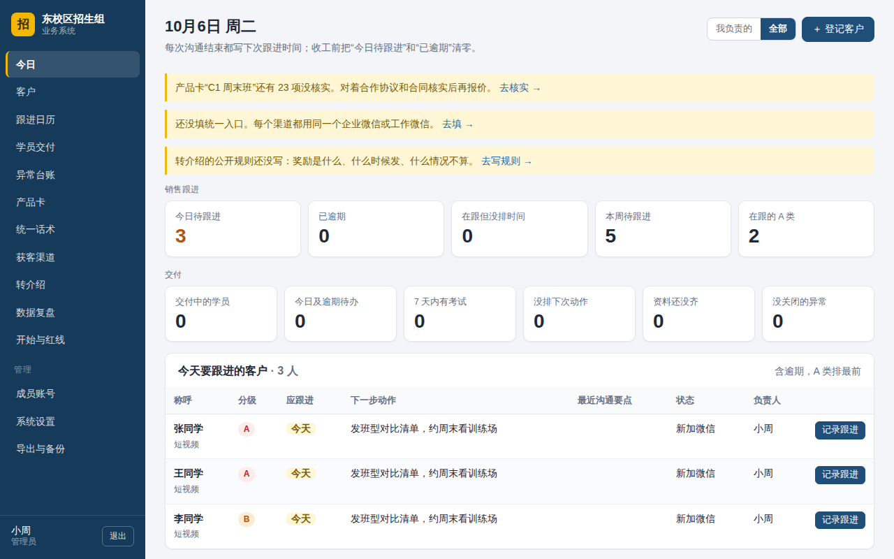
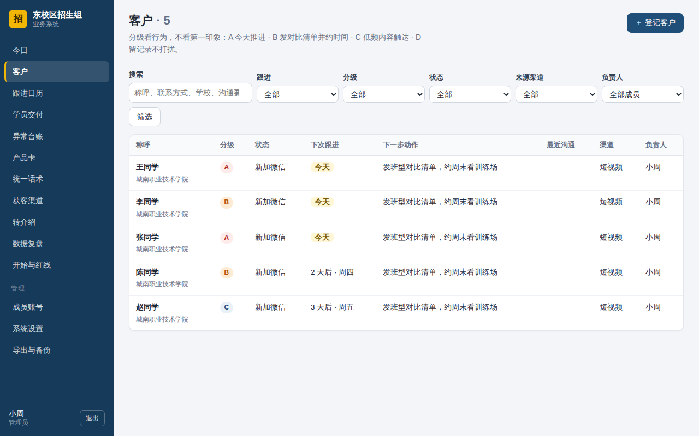
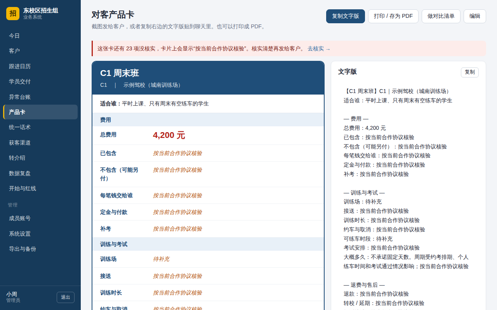
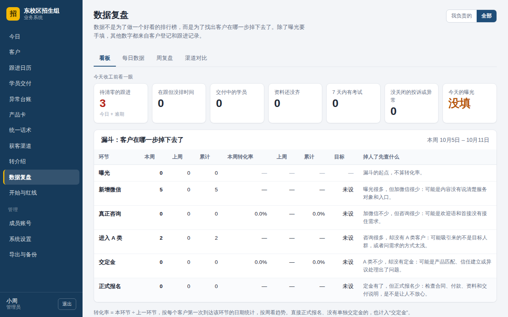
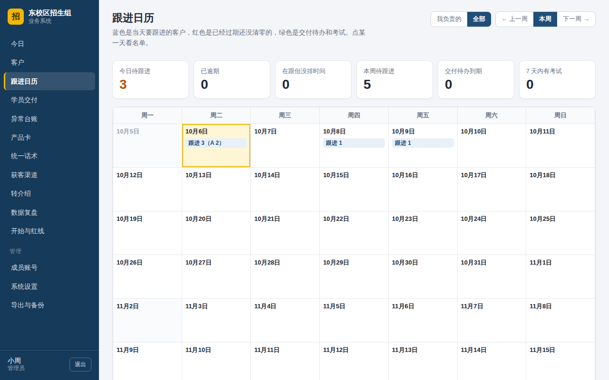
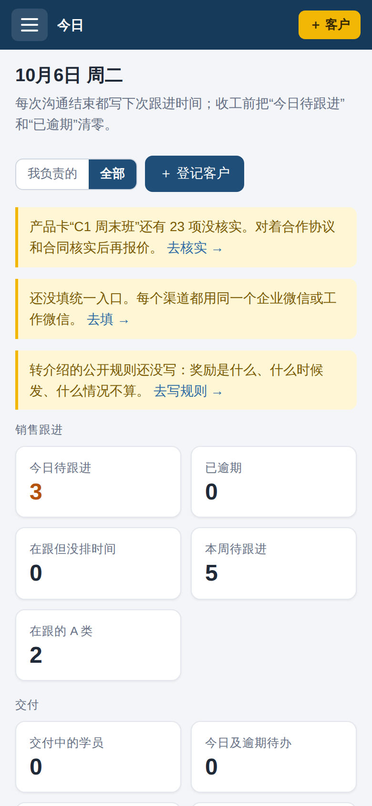

<div align="center">


# Driving School Enrollment Management System
### 驾校招生业务系统

**A lightweight, open-source workflow tool for small campus driving-school enrollment teams.**

Manage the journey from **offerings → lead generation → customer follow-ups → enrollment → student delivery → aftercare → referrals**.

**Two independent deployments:** a self-hosted Python/SQLite web application and a WeChat Mini Program backed by WeChat Cloud Development. Their data is **not synchronized**.

**Language:** [简体中文](README.md) | **English**

[](https://github.com/a16689525392-prog/jiaxiaohuoke/actions/workflows/ci.yml)


[](LICENSE)

[Choose an edition](#choose-an-edition) · [Features](#features) · [Screenshots](#screenshots) · [Quick start](#quick-start-web-edition) · [Deployment](#ubuntu-deployment) · [Security](#security-and-privacy) · [Contribute](#development-and-contributing)

</div>

---

## Overview

This project helps small teams keep track of contacts, next actions, enrollment steps, student service tasks, operational issues, and referrals. It is designed for organizations that want a straightforward internal tool rather than a complex commercial CRM.

The project provides two **separate** implementations. Pick the one that fits your operating environment; they do not share a database.

## Choose an edition

| | Web edition | WeChat Mini Program |
| --- | --- | --- |
| Code location | Repository root | [`wechat-miniprogram/`](wechat-miniprogram/) |
| Hosting | Your Ubuntu machine or Docker | Your WeChat Cloud Development environment |
| Access | Browser on a computer or phone, typically on the same private network | Inside WeChat |
| Storage | Local SQLite database | WeChat cloud database |
| Identity | Team accounts with admin/member roles | WeChat identity, teams and invitations |
| Focus | Full workflow, reporting, CSV export and backups | Everyday customer and student workflows |
| Setup guide | Below | [Mini Program guide (Chinese)](wechat-miniprogram/README.md) |

**Important:** The two editions use similar business rules but store separate data. The Mini Program requires your own WeChat Mini Program account and cloud environment, and cloud usage may incur charges.

## Features

### Web edition

- **Leads and customers:** customer records, A/B/C/D prioritization, follow-up notes and scheduled next actions.
- **Daily workspace and calendar:** overdue contacts, upcoming follow-ups, delivery tasks and exams.
- **Enrollment and delivery:** pre-payment checks, deposit/enrollment tracking, student onboarding and milestones.
- **Internal knowledge:** product cards, standard messaging, acquisition channels and content topics.
- **Operations:** exception/complaint log, referrals, funnel overview and periodic review.
- **Team collaboration:** administrator and member roles; optional restriction of members to assigned customers.
- **Data ownership:** SQLite storage, backup/restore functions and CSV exports.
- **Lightweight runtime:** the web application uses the Python standard library and SQLite rather than third-party Python packages.

### WeChat Mini Program

- Daily tasks, lead registration and follow-up management.
- Enrollment checks and student delivery milestones.
- Product information, scripts, channels and referrals.
- Team invitations, role-based access and a built-in self-check.
- WeChat cloud functions and database for storage and access control.

The Mini Program does **not** currently include all web reporting and export features. Refer to the [Chinese README](README.md#和网页版的区别) for the detailed feature differences.

## Screenshots

Images in the repository use **demonstration data**, not claims of customer adoption.

| Dashboard | Customers |
| --- | --- |
|  |  |
| Product card | Analytics |
|  |  |
| Follow-up calendar | Mobile view |
|  |  |

The Mini Program preview images are generated by a local rendering script and may not exactly match a real-device build. See [Chinese documentation](README.md#-微信小程序版).

## Quick start (web edition)

**Requirements:** Python 3.8+ and Git, on Windows, macOS or Linux for local evaluation.

```bash
git clone https://github.com/a16689525392-prog/jiaxiaohuoke.git jiaxiao
cd jiaxiao
python3 run.py
```

On some Windows installations, use `python run.py` instead of `python3 run.py`.

Read the **initial setup code** printed in the terminal. Open `http://127.0.0.1:8000`, enter the code, then create the first administrator. By default, local data is stored under `data/`. Stop the server with `Ctrl+C`.

## Ubuntu deployment

The repository documents deployment on Ubuntu 20.04, 22.04 and 24.04:

```bash
git clone https://github.com/a16689525392-prog/jiaxiaohuoke.git jiaxiao
cd jiaxiao
sudo bash install.sh
```

The installer sets up a dedicated system account, application files, local data storage and a systemd service. Common management commands:

```bash
sudo jiaxiao status
sudo jiaxiao logs
sudo jiaxiao backup
sudo jiaxiao restart
```

See the [full Chinese deployment guide](README.md#一安装ubuntu) for port settings, upgrades, restores and uninstall instructions.

### Docker alternative

If Docker and Docker Compose are already available:

```bash
git clone https://github.com/a16689525392-prog/jiaxiaohuoke.git jiaxiao
cd jiaxiao
docker compose up -d --build
docker compose logs jiaxiao
```

Find the initialization code in the logs before creating the administrator. **Use either the native installer or Docker, not both on the same port.**

The Compose configuration may bind a port to all host interfaces. Review its network exposure before starting the service.

## WeChat Mini Program deployment

The Mini Program is in [`wechat-miniprogram/`](wechat-miniprogram/). In brief:

1. Import that folder into WeChat Developer Tools using **your own Mini Program AppID**.
2. Enable/select your own WeChat Cloud Development environment.
3. **Change `TEAM_CREATE_CODE`** in `wechat-miniprogram/cloudfunctions/api/config.js` before deployment. Never use the public default code.
4. Deploy the `cloudfunctions/api` cloud function.
5. Create a team and run the in-app self-check.

For full instructions, publishing prerequisites, and database permissions, read [wechat-miniprogram/README.md](wechat-miniprogram/README.md) (Chinese). The Mini Program has its own local tests; test results do not substitute for on-device and cloud verification.

## Security and privacy

- **Intended network:** the web edition is primarily designed for a local or private network. It serves plain HTTP and **must not be exposed directly to the public internet**.
- If remote access is required, use a private network/VPN or set up a properly configured HTTPS reverse proxy and additional access controls.
- Store only the personal information required for business workflows. Do not post exported customer data in public issues or screenshots.
- Keep passwords, initial setup codes, cloud environment identifiers where sensitive, and API credentials out of Git.
- **Mini Program:** do not relax cloud database collection permissions to make all records publicly readable.
- Report security issues privately to the maintainers rather than posting exploitable details in a public issue.

Security and operational claims in this README describe the project's intended design; you should evaluate the configuration for your own deployment.

## Development and contributing

### Repository layout

```text
run.py                   Web entry point and CLI
app/                     Web routes, authentication, database and business logic
templates/               HTML templates
static/                  Front-end assets
tests/                   Web automated tests
deploy/                  Ubuntu / systemd deployment support
docs/screenshots/        Demonstration images
wechat-miniprogram/      Independent Mini Program implementation and tests
.github/                 CI workflows
```

### Run tests

```bash
python3 -m unittest discover -s tests -v
(cd wechat-miniprogram && node --test tests/test_*.js)
```

The Mini Program tests require Node.js 18 or later. GitHub Actions also runs test jobs; check the live [Actions page](https://github.com/a16689525392-prog/jiaxiaohuoke/actions) for their latest outcome rather than treating any README statement as proof that CI currently passes.

Contributions via Issues and Pull Requests are welcome. Please include reproduction steps for bugs and test coverage for behavioral changes. Keep the web edition free of third-party Python runtime dependencies and avoid introducing unnecessary Mini Program dependencies.

For the Chinese development notes and release instructions, see [README.md](README.md#-参与开发) and [CHANGELOG.md](CHANGELOG.md).

## Project scope and limitations

This is a tool for managing an enrollment team's internal workflow. It is **not** an official school registration, licensing, examination or government service.

Some sample scripts and operational checklists originate from business-process notes and have **not** been independently verified. Verify prices, fees, exam arrangements, refund terms and service promises against local requirements and the relevant signed agreement.

No GitHub stars, downloads, actual production deployments or customers are claimed by this documentation.

## License

[MIT](LICENSE)
